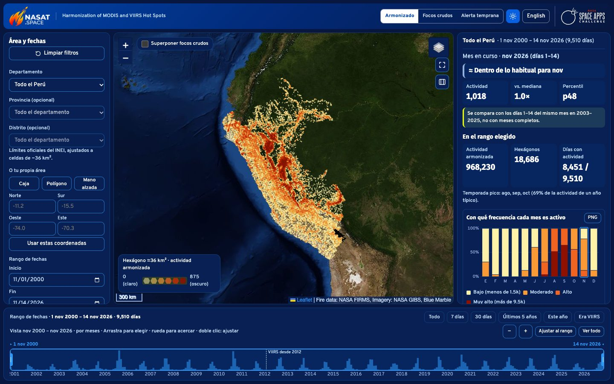
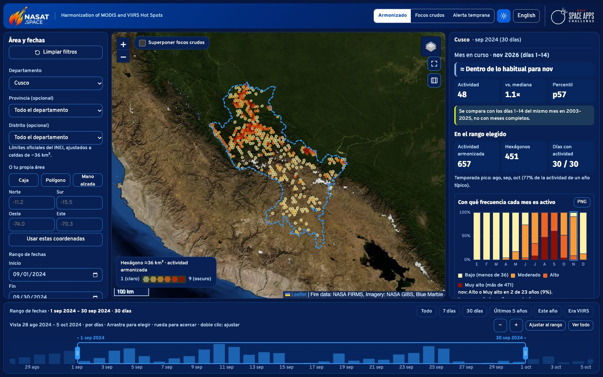
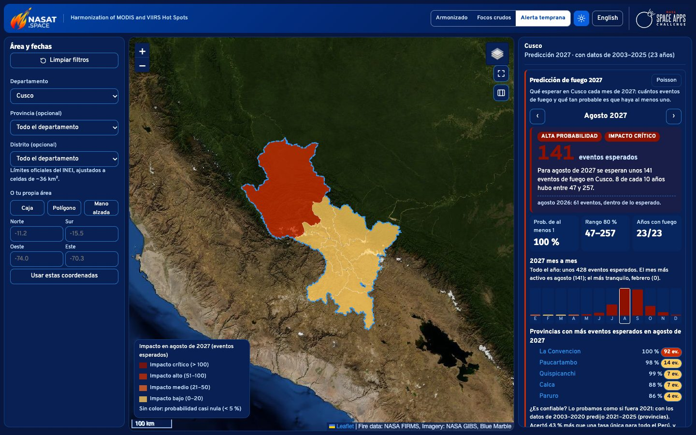
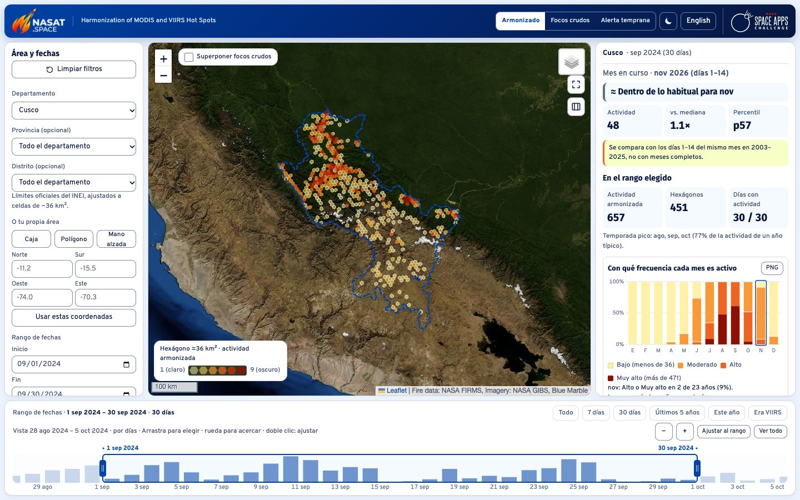
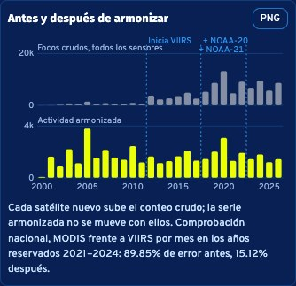
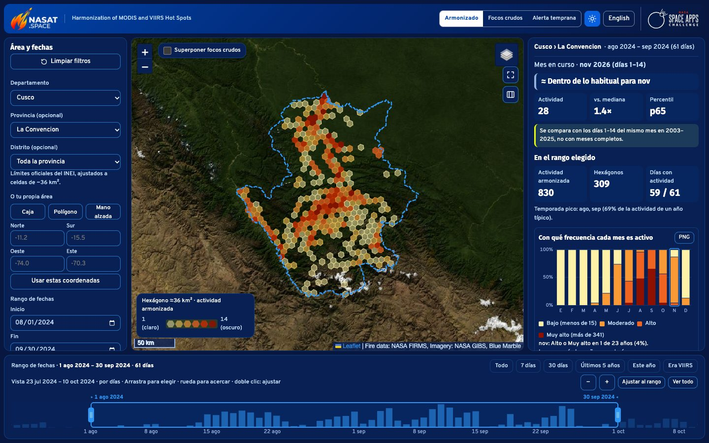
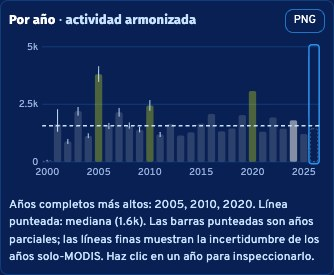
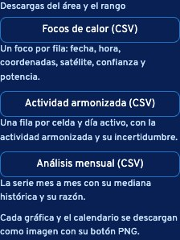

# Calendario de quema · Perú

Proyecto del reto **Harmonization of MODIS and VIIRS Hot Spots** (NASA Space Apps Challenge 2026).
Aplicación web con un calendario de actividad de quema sobre focos de calor de MODIS y VIIRS armonizados (NASA FIRMS), para el área y el rango de fechas que elige el usuario.

```
web/  ──►  functions/  ──►  data/  ◄──  src/etl/  ◄──  FIRMS
```

## Capturas

Tomadas de la app desplegada (<https://fire-calendar-538134722054.us-east1.run.app>) el 15 de noviembre de 2026. La interfaz usa la paleta de NASA Space Apps, en tema oscuro y claro, y tiene tres pestañas: **Armonizado**, **Focos crudos** y **Alerta temprana**.

**Armonizado · todo el Perú.** Hexágonos de ~36 km² con la actividad armonizada (MODIS y VIIRS en la misma escala), el mes en curso frente a su mediana, los totales del rango y la línea de tiempo de 2000 a hoy.



**Cusco, septiembre de 2024.** Área por límite oficial del INEI y rango de fechas por días.



**Focos crudos.** Cada foco con su buffer (375 m VIIRS, 1 km MODIS), disueltos por día en eventos de fuego; estadísticas por sensor, satélite, día/noche y confianza.


**Alerta temprana · predicción 2027.** Eventos esperados por mes (modelo de Poisson sobre eventos MODIS, verificado fuera de muestra), probabilidad e impacto; el mapa baja de departamento a provincia y distrito.



**Ranking de departamentos en el rango.** Hexágonos, focos y eventos (destacados), con límites oficiales del INEI.


**Tema claro, para uso en campo.** La rampa de fuego es la misma en los dos temas.



## Criterios del hackathon y estado

Estado al 15 de noviembre de 2026. El cierre del envío es el domingo 15 de noviembre a las 11:59 p. m.

### Lo que pide el enunciado

| Criterio | Estado | Dónde | Captura |
|---|---|---|---|
| Armonizar MODIS y VIIRS hasta que el sensor no importe | ✅ Cumplido | `src/etl/harmonize_firms.py`; error mensual entre sensores de 89,9 % a 15,1 % en años reservados (2021–2024) | <a href="docs/img/06-armonizacion.jpg"></a> |
| Aplicación web sobre los datos armonizados | ✅ Cumplido | `web/` + `functions/`, desplegada en Cloud Run | <a href="docs/img/01-peru.jpg"></a> |
| Elegir región en el mapa y por coordenadas | ✅ Cumplido | Departamento › provincia › distrito (INEI), dibujar caja, polígono o mano alzada, o coordenadas N/S/O/E | <a href="docs/img/07-area.jpg"></a> |
| Elegir rango de fechas | ✅ Cumplido | Inicio y fin por días, atajos y línea de tiempo con zoom de años a días | <a href="docs/img/08-focos-rango.jpg"></a> |
| Calendario desde inicios de los 2000 hasta hoy | ✅ Cumplido | Noviembre de 2000 a noviembre de 2026, con el número en cada celda | <a href="docs/img/03-calendario.jpg"></a> |
| Qué periodos del año tienen más fuego | ✅ Cumplido | Temporada pico y frecuencia de cada nivel por mes | <a href="docs/img/09-frecuencia.jpg"></a> |
| Qué años tuvieron más quema | ✅ Cumplido | Gráfica "Por año" (armonizada: los años se comparan) | <a href="docs/img/10-anios.jpg"></a> |
| Mes actual frente a la mediana histórica | ✅ Cumplido | Lectura, razón y percentil, comparando los mismos días del mes | <a href="docs/img/11-mes-actual.jpg"></a> |
| Rampas de color accesibles | ✅ Cumplido | Rampa secuencial amarillo → rojo (rojo = más), igual en los dos temas, de luminosidad siempre decreciente y con número en cada celda. Comprobada con simulación de daltonismo (`npm --prefix web run check:palette`), no con personas | <a href="docs/img/05-tema-claro.jpg"></a> |
| CSV de los focos detectados en la búsqueda | ✅ Cumplido | "Focos de calor (CSV)", un foco por fila | <a href="docs/img/12-descargas.jpg"></a> |
| Descargar análisis y visualizaciones | ✅ Cumplido | CSV de la actividad armonizada y del análisis mensual; PNG de cada gráfica y del calendario (botón "PNG") | <a href="docs/img/10-anios.jpg"></a> |
| Anomalías frente a promedios multianuales | ✅ Cumplido | Año frente a un año normal, con mediana y rango habitual | <a href="docs/img/13-anomalia.jpg"></a> |
| Extra: alerta temprana | ✅ Añadido | Predicción 2027 por mes (Poisson / Poisson-Gamma sobre eventos MODIS), verificada en 2021–2025: rango del 80 % cumplido en 83–96 % de los casos | <a href="docs/img/14-alerta-temprana.jpg"></a> |

### Reglas del envío

| Regla | Estado |
|---|---|
| Usar al menos un dato de NASA | ✅ Todo sale de NASA FIRMS |
| Trabajo original hecho durante el hackathon | ✅ |
| Enlace público a la app, sin registro | ✅ <https://fire-calendar-538134722054.us-east1.run.app> (Cloud Run) |
| Página del proyecto con sus ocho campos | ❌ Pendiente: textos listos en [docs/08-envio.md](docs/08-envio.md) |
| Demo de 7 diapositivas o video de 30 s | ❌ Pendiente: guion listo en [docs/08-envio.md](docs/08-envio.md) |
| Declarar el uso de IA | ⚠️ Borrador listo; falta lo que hizo cada integrante |
| Referencias de todo lo externo | ⚠️ Borrador listo, más abajo |
| Equipo de seis personas como máximo | Por confirmar por el equipo |

### Criterios del jurado (1 a 5 cada uno)

| Criterio | Cómo lo cubre el proyecto | Estado |
|---|---|---|
| Impacto | Gestores de emergencias en el Perú; caso Cusco; interfaz en español | Cubierto en la app |
| Creatividad | Armonización con incertidumbre visible, eventos de fuego por buffer y disolución, lectura en palabras del mes | Cubierto en la app |
| Validez | Validación en años reservados y límites declarados en pantalla | Cubierto en la app |
| Relevancia | Checklist del enunciado completo; FIRMS es todo el dato | Cubierto en la app |
| Presentación | Interfaz con la paleta de NASA Space Apps, en tema claro y oscuro. El resto depende de la página del proyecto y la demo | ⚠️ Interfaz lista; página y demo sin empezar |

## Estructura

| Carpeta | Qué es |
|---|---|
| `data/` | Archivos de FIRMS y `data/processed/harmonized_fires.parquet` (serie armonizada) |
| `src/etl/` | `harmonize_firms.py` (armonización y validación), `fire_events.py` (eventos de fuego por buffer y disolución diaria) y `peru_limits.py` (límites oficiales del INEI) |
| `functions/` | Servicios headless (Python, DuckDB, FastAPI): JSON y CSV para cualquier cliente |
| `web/` | Aplicación (Vite, TypeScript, Leaflet). Solo habla con `functions/` |
| `docs/` | Análisis del reto, método y arquitectura ([docs/06-arquitectura-ddd.md](docs/06-arquitectura-ddd.md)) |

## Ejecutar

Requisitos: [uv](https://docs.astral.sh/uv/) y Node 20 o superior.

Todo en un solo servidor (la API sirve también la web compilada):

```bash
npm --prefix web install && npm --prefix web run build
```

```bash
cd functions && uv run uvicorn --factory fire_calendar.interfaces.http.app:create_app --port 8000
```

Abrir <http://localhost:8000>. La API queda en `/api/v1` y su documentación en `/api/docs`.

Para desarrollar la web con recarga automática, dejar la API en el puerto 8000 y en otra terminal:

```bash
npm --prefix web run dev
```

## Pruebas

```bash
cd functions && uv run pytest
```

```bash
npm --prefix web run typecheck
```

Las pruebas de `functions/` cubren las reglas del dominio y la API contra el parquet real.

## Regenerar los datos

```bash
uv run --with pandas --with numpy --with h3 --with pyarrow python src/etl/harmonize_firms.py
```

```bash
uv run --with pandas --with numpy --with scipy --with h3 --with pyarrow python src/etl/fire_events.py
```

`fire_events.py` escribe `fire_events.parquet` (eventos de fuego) y `hotspots_clean.parquet` (focos limpios, uno por fila, para la descarga CSV de focos). Ambos son opcionales: sin ellos la app funciona, muestra los eventos como no disponibles y oculta la descarga de focos.

`peru_limits.py` descarga los límites oficiales del INEI (Geoservidor WFS Interoperabilidad: departamentos, provincias y distritos) y escribe `peru_limits.json`: contornos simplificados y, para cada departamento y distrito, las celdas H3 res 6 cuyo centro cae dentro. Con este archivo la app elige el área por límites oficiales; sin él, usa el departamento aproximado de la serie.

## Desplegar

**App pública:** <https://fire-calendar-538134722054.us-east1.run.app> (sin registro; `?lang=en` la abre en inglés).

Un solo contenedor en **Google Cloud Run** (proyecto `nasat-fire-calendar`, región `us-east1`). El `Dockerfile` construye la web y arranca `functions/`, que sirve la API y la web en el mismo puerto. Los datos de `data/processed/` van dentro de la imagen: cada revisión lleva el código y los datos que le corresponden, y volver atrás mueve ambos.

```
Navegador ──HTTPS──► Cloud Run "fire-calendar" (1 vCPU, 2 GiB, 0–3 instancias)
                      uvicorn + FastAPI: /api/v1 (JSON, CSV) y / (web compilada)
                      DuckDB en memoria ◄── data/processed/ dentro de la imagen
Teselas del mapa: el navegador las pide directo a NASA GIBS y OpenStreetMap.
```

Probar la imagen en local:

```bash
docker build -t fire-calendar . && docker run --rm -p 8080:8080 fire-calendar
```

Publicar una nueva versión (por ejemplo, tras regenerar los datos):

```bash
gcloud run deploy fire-calendar --source . --project nasat-fire-calendar --region us-east1 --allow-unauthenticated --memory 2Gi --cpu 1 --concurrency 40 --min-instances 0 --max-instances 3 --timeout 900
```

- Arranca en ~1 s y usa ~370 MB. Tres exportaciones completas a la vez llegaron a ~1 GB, así que DuckDB queda limitado a 1 GB (`DUCKDB_MEMORY_LIMIT`) y el servicio tiene 2 GiB. Lo que no cabe se escribe a `/tmp`.
- La exportación CSV de todos los focos (2,2 millones de filas) tarda ~3 min; el tiempo máximo por petición es de 15 min.
- Escala a cero: tras un rato sin visitas, la primera carga tarda unos segundos más. Para una demo en vivo, `--min-instances 1` y luego volver a 0.
- Presupuesto con alertas al 50 % y 100 % de S/ 40 al mes en la cuenta de facturación del proyecto.
- `.gcloudignore` evita subir a Cloud Build los CSV crudos de FIRMS.

## Límites que la app declara

- Un foco de calor es una detección térmica, no un incendio confirmado.
- Sin observación (nubes, humo) no significa cero fuego.
- Un evento de fuego es un grupo de focos cuyos buffers se tocan el mismo día; un incendio de varios días cuenta una vez por día.
- Los focos crudos y los eventos no son comparables entre años; la actividad armonizada sí.
- Antes de mediados de 2002 solo volaba Terra: esos valores son de baja confianza.
- Departamentos, provincias y distritos siguen los límites oficiales del INEI, ajustados a celdas H3 de ~36 km².
- La predicción de Alerta temprana es estacional (lo que suele pasar cada mes desde 2003), no un pronóstico del tiempo; cuenta solo eventos MODIS para que todos los años cuenten igual.

## Para la página del proyecto

**Datos de NASA:** FIRMS (Fire Information for Resource Management System): MODIS Collection 6.1 (Terra, Aqua) y VIIRS Collection 2 (S-NPP, NOAA-20, NOAA-21), archivo y casi tiempo real, Perú, noviembre de 2000 a noviembre de 2026. Mapa base por defecto y globo 3D de la intro: NASA GIBS, Blue Marble.

**Referencias externas (código y datos):**

- Leaflet (BSD-2-Clause) · mapa
- Logo oficial de NASA Space Apps, sin alterar, y paleta, degradado y tipografías de su guía de marca · Fira Sans y Overpass (SIL OFL, Google Fonts)
- OpenStreetMap (ODbL) · teselas del mapa base
- DuckDB (MIT) · consultas sobre el parquet
- FastAPI (MIT), Uvicorn (BSD-3-Clause) · servicio HTTP
- H3 de Uber (Apache-2.0) · grilla hexagonal
- pandas, NumPy, SciPy (BSD-3-Clause), PyArrow (Apache-2.0) · ETL
- Vite (MIT), TypeScript (Apache-2.0) · compilación de la web

**Uso de IA:** se usó Claude (Anthropic), mediante Claude Code, para analizar el enunciado y las reglas, revisar la serie armonizada, escribir `src/etl/fire_events.py`, `functions/` y `web/`, y redactar documentación. El equipo descargó los datos de FIRMS, construyó la armonización (`src/etl/harmonize_firms.py`) y revisó los resultados. El logo de NASAT se generó con una herramienta de IA de imágenes (indicar cuál). Completar con el uso real de cada integrante antes de enviar.
