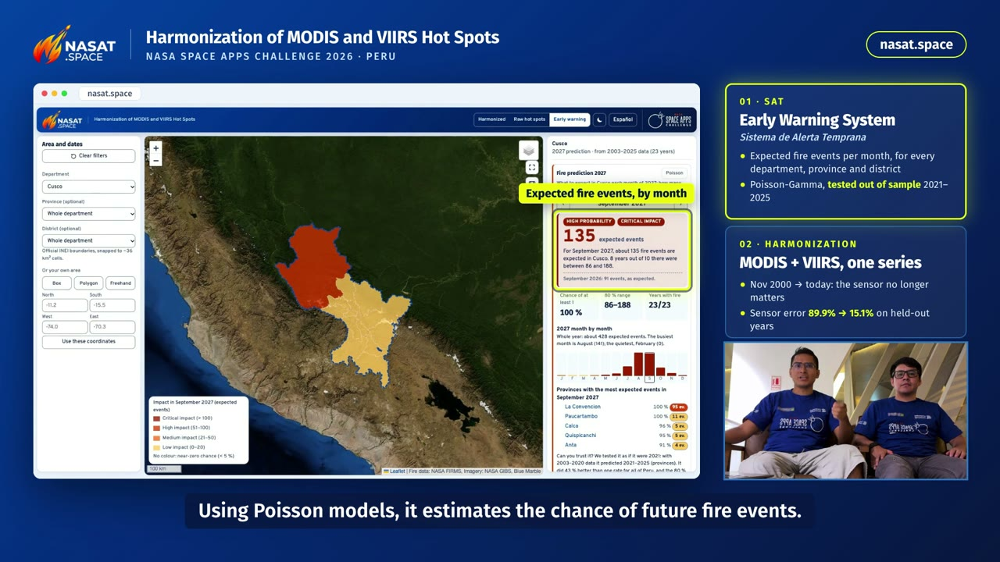
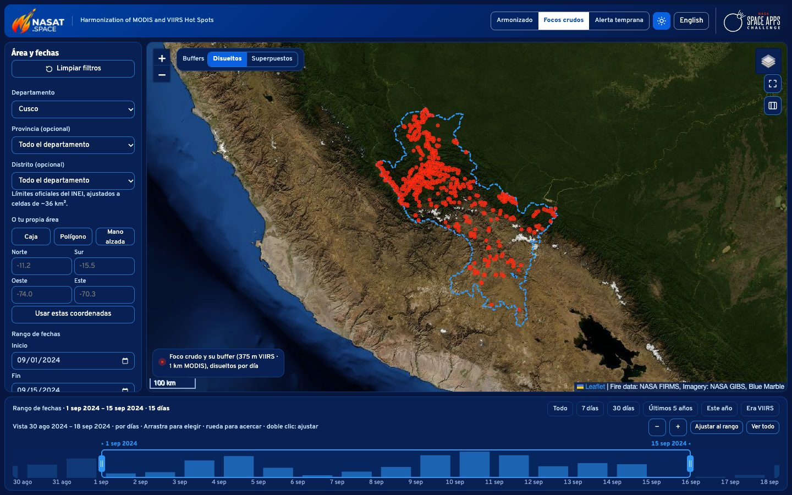
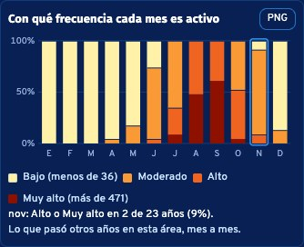
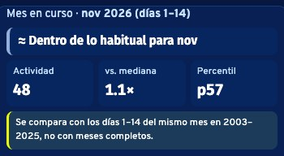
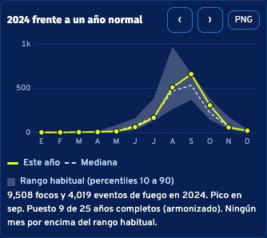

# Burn Calendar · Peru

<p align="center">
  <a href="https://youtu.be/a8X_l8E2iQA" title="Watch the NASAT.space demo on YouTube">
    
  </a>
  <br>
  <a href="https://youtu.be/a8X_l8E2iQA"><b>▶ Watch the demo on YouTube (30 s)</b></a> · <a href="https://nasat.space">nasat.space</a>
</p>

Project for the **Harmonization of MODIS and VIIRS Hot Spots** challenge (NASA Space Apps Challenge 2026).
A web application with a burn-activity calendar built on harmonized MODIS and VIIRS hot spots (NASA FIRMS), for the area and date range the user chooses.

```
web/  ──►  functions/  ──►  data/  ◄──  src/etl/  ◄──  FIRMS
```

## Screenshots

Taken from the deployed app (<https://fire-calendar-538134722054.us-east1.run.app>) on November 15, 2026. The interface uses the NASA Space Apps palette, in dark and light themes, and has three tabs: **Harmonized**, **Raw hot spots** and **Early warning**.

**Harmonized · all of Peru.** ~36 km² hexagons with harmonized activity (MODIS and VIIRS on the same scale), the current month against its median, the totals for the range, and the timeline from 2000 to today.


**Cusco, September 2024.** Area by official INEI boundary and date range by days.


**Raw hot spots.** The raw data, with no statistics panel: each hot spot with its buffer (375 m VIIRS, 1 km MODIS), dissolved per day into fire events, and the timeline by days. Clicking a hot spot shows its details and its event.



**Early warning · 2027 forecast.** Expected events per month (Poisson model on MODIS events, verified out of sample), probability and impact; the map drills down from department to province and district.


**Department ranking within the range.** Hexagons, hot spots and events (highlighted), with official INEI boundaries.


**Light theme, for field use.** The fire ramp is the same in both themes.


## Hackathon criteria and status

Status as of November 15, 2026. The submission deadline is Sunday, November 15 at 11:59 p.m.

### What the challenge asks for

| Criterion | Status | Where | Screenshot |
|---|---|---|---|
| Harmonize MODIS and VIIRS until the sensor no longer matters | ✅ Done | `src/etl/harmonize_firms.py`; monthly cross-sensor error from 89.9% down to 15.1% on held-out years (2021–2024) | <a href="docs/img/06-armonizacion.jpg"></a> |
| Web application on the harmonized data | ✅ Done | `web/` + `functions/`, deployed on Cloud Run | <a href="docs/img/01-peru.jpg"></a> |
| Choose a region on the map and by coordinates | ✅ Done | Department › province › district (INEI), draw a box, polygon or freehand shape, or N/S/W/E coordinates | <a href="docs/img/07-area.jpg"></a> |
| Choose a date range | ✅ Done | Start and end by days, shortcuts, and a timeline that zooms from years to days | <a href="docs/img/08-focos-rango.jpg"></a> |
| Calendar from the early 2000s to today | ✅ Done | November 2000 to November 2026, with the number in each cell | <a href="docs/img/03-calendario.jpg"></a> |
| Which periods of the year have the most fire | ✅ Done | Peak season and frequency of each level by month | <a href="docs/img/09-frecuencia.jpg"></a> |
| Which years had the most burning | ✅ Done | "By year" chart (harmonized: years can be compared) | <a href="docs/img/10-anios.jpg"></a> |
| Current month against the historical median | ✅ Done | Reading, ratio and percentile, comparing the same days of the month | <a href="docs/img/11-mes-actual.jpg"></a> |
| Accessible color ramps | ✅ Done | Sequential yellow → red ramp (red = more), identical in both themes, with strictly decreasing lightness and a number in each cell. Checked with color-blindness simulation (`npm --prefix web run check:palette`), not with people | <a href="docs/img/05-tema-claro.jpg"></a> |
| CSV of the hot spots found by the search | ✅ Done | "Hot spots (CSV)", one hot spot per row | <a href="docs/img/12-descargas.jpg"></a> |
| Download analyses and visualizations | ✅ Done | CSV of the harmonized activity and of the monthly analysis; PNG of each chart and of the calendar ("PNG" button) | <a href="docs/img/10-anios.jpg"></a> |
| Anomalies against multi-year averages | ✅ Done | Year against a normal year, with median and usual range | <a href="docs/img/13-anomalia.jpg"></a> |
| Extra: early warning | ✅ Added | 2027 forecast by month (Poisson / Poisson-Gamma on MODIS events), verified on 2021–2025: the 80% range held in 83–96% of cases | <a href="docs/img/14-alerta-temprana.jpg"></a> |

### Submission rules

Checked on November 15, 2026 at 11:10 p.m. (Peru time).

| Rule | Status |
|---|---|
| Use at least one NASA dataset | ✅ Every number comes from NASA FIRMS (MODIS C6.1, VIIRS C2); base map from NASA GIBS |
| Original work done during the hackathon | ✅ |
| Public link to the app, no sign-up | ✅ <https://nasat.space> and <https://fire-calendar-538134722054.us-east1.run.app> open without login (HTTP 200) |
| Public link to the project | ✅ Public repository: <https://github.com/binnicordova/ai-NASA-hackathon> |
| Project page with its eight fields | ✅ Completed by the team (source texts in [docs/08-envio.md](docs/08-envio.md)) |
| 7-slide demo or 30 s video | ✅ Public YouTube video, exactly 30 s: <https://youtu.be/a8X_l8E2iQA> |
| Declare the use of AI | ⚠️ Declared below; still to add the AI image tool used for the NASAT logo and each member's own use |
| References for everything external | ✅ Listed below (data, code, fonts, brand, color science) |
| No copyrighted material | ✅ Official Space Apps logo unaltered per its brand guide, open-licensed fonts, screenshots and video of our own app |
| No secrets in the repository | ✅ The FIRMS `MAP_KEY` is not in the code |
| Team of six people at most | To be confirmed by the team |
| Submit by Sunday, November 15, 11:59 p.m. local time | ⏳ Everything is ready; the team presses submit before the deadline |

### Judging criteria (1 to 5 each)

| Criterion | How the project covers it | Status |
|---|---|---|
| Impact | Emergency managers in Peru; Cusco case; Spanish interface (English also available) | Covered in the app |
| Creativity | Harmonization with visible uncertainty, fire events by buffer and dissolve, plain-language reading of the month | Covered in the app |
| Validity | Validation on held-out years and limitations stated on screen | Covered in the app |
| Relevance | Full challenge checklist; FIRMS is all the data | Covered in the app |
| Presentation | Interface with the NASA Space Apps palette, in light and dark themes; 30 s video demo and project page | ✅ Interface, project page and demo ready |

## Structure

| Folder | What it is |
|---|---|
| `data/` | FIRMS files and `data/processed/harmonized_fires.parquet` (harmonized series) |
| `src/etl/` | `harmonize_firms.py` (harmonization and validation), `fire_events.py` (fire events by buffer and daily dissolve) and `peru_limits.py` (official INEI boundaries) |
| `functions/` | Headless services (Python, DuckDB, FastAPI): JSON and CSV for any client |
| `web/` | Application (Vite, TypeScript, Leaflet). Talks only to `functions/` |
| `docs/` | Challenge analysis, method and architecture ([docs/06-arquitectura-ddd.md](docs/06-arquitectura-ddd.md)) |

## Run

Requirements: [uv](https://docs.astral.sh/uv/) and Node 20 or later.

Everything on a single server (the API also serves the compiled web app):

```bash
npm --prefix web install && npm --prefix web run build
```

```bash
cd functions && uv run uvicorn --factory fire_calendar.interfaces.http.app:create_app --port 8000
```

Open <http://localhost:8000>. The API lives at `/api/v1` and its documentation at `/api/docs`.

To develop the web app with hot reload, keep the API on port 8000 and, in another terminal:

```bash
npm --prefix web run dev
```

## Tests

```bash
cd functions && uv run pytest
```

```bash
npm --prefix web run typecheck
```

The `functions/` tests cover the domain rules and the API against the real parquet.

## Regenerate the data

```bash
uv run --with pandas --with numpy --with h3 --with pyarrow python src/etl/harmonize_firms.py
```

```bash
uv run --with pandas --with numpy --with scipy --with h3 --with pyarrow python src/etl/fire_events.py
```

`fire_events.py` writes `fire_events.parquet` (fire events) and `hotspots_clean.parquet` (clean hot spots, one per row, for the hot spot CSV download). Both are optional: without them the app still works, shows events as unavailable and hides the hot spot download.

`peru_limits.py` downloads the official INEI boundaries (Geoservidor WFS Interoperabilidad: departments, provinces and districts) and writes `peru_limits.json`: simplified outlines and, for each department and district, the H3 res 6 cells whose center falls inside. With this file the app selects areas by official boundaries; without it, it uses the series' approximate department.

## Deploy

**Public app:** <https://fire-calendar-538134722054.us-east1.run.app> (no sign-up; `?lang=en` opens it in English).

A single container on **Google Cloud Run** (project `nasat-fire-calendar`, region `us-east1`). The `Dockerfile` builds the web app and starts `functions/`, which serves the API and the web app on the same port. The data in `data/processed/` ships inside the image: each revision carries its matching code and data, and rolling back moves both.

```
Browser ──HTTPS──► Cloud Run "fire-calendar" (1 vCPU, 2 GiB, 0–3 instances)
                   uvicorn + FastAPI: /api/v1 (JSON, CSV) and / (compiled web app)
                   In-memory DuckDB ◄── data/processed/ inside the image
Map tiles: the browser requests them directly from NASA GIBS and OpenStreetMap.
```

Test the image locally:

```bash
docker build -t fire-calendar . && docker run --rm -p 8080:8080 fire-calendar
```

Publish a new version (for example, after regenerating the data):

```bash
gcloud run deploy fire-calendar --source . --project nasat-fire-calendar --region us-east1 --allow-unauthenticated --memory 2Gi --cpu 1 --concurrency 40 --min-instances 0 --max-instances 3 --timeout 900
```

- Starts in ~1 s and uses ~370 MB. Three full exports at once reached ~1 GB, so DuckDB is capped at 1 GB (`DUCKDB_MEMORY_LIMIT`) and the service has 2 GiB. Whatever doesn't fit spills to `/tmp`.
- The CSV export of all hot spots (2.2 million rows) takes ~3 min; the maximum request time is 15 min.
- Scales to zero: after a while with no visits, the first load takes a few extra seconds. For a live demo, use `--min-instances 1` and then set it back to 0.
- Budget with alerts at 50% and 100% of S/ 40 per month on the project's billing account.
- `.gcloudignore` keeps the raw FIRMS CSVs from being uploaded to Cloud Build.

### Continuous deployment

[`.github/workflows/deploy.yml`](.github/workflows/deploy.yml) publishes a new revision every time a change to `Dockerfile`, `.gcloudignore`, `functions/`, `web/`, `data/processed/` or the workflow itself reaches `main`. It first runs the `functions/` tests and the `web/` type check; if they fail, it does not deploy. After deploying it checks that `/` and `/api/v1/meta` respond. It can also be triggered manually from the Actions tab ("Run workflow").

GitHub accesses Google Cloud without stored keys: the workflow's OIDC token is exchanged for short-lived credentials of the `github-deployer` service account (Workload Identity Federation). The provider only accepts tokens from this repository and the `main` branch. The account has the minimum permissions to deploy from source: `roles/run.sourceDeveloper`, `roles/serviceusage.serviceUsageConsumer` and `roles/iam.serviceAccountUser` on the account the service runs as.

One-time setup (already done; useful to redo it in another project):

```bash
PROJECT=nasat-fire-calendar; NUM=538134722054; REPO=binnicordova/ai-NASA-hackathon
SA=github-deployer@$PROJECT.iam.gserviceaccount.com
gcloud services enable sts.googleapis.com iamcredentials.googleapis.com --project $PROJECT
gcloud iam service-accounts create github-deployer --project $PROJECT --display-name "GitHub Actions: despliegue a Cloud Run"
for ROLE in roles/run.sourceDeveloper roles/serviceusage.serviceUsageConsumer; do
  gcloud projects add-iam-policy-binding $PROJECT --member "serviceAccount:$SA" --role $ROLE --condition None
done
gcloud iam service-accounts add-iam-policy-binding $NUM-compute@developer.gserviceaccount.com --project $PROJECT --member "serviceAccount:$SA" --role roles/iam.serviceAccountUser
gcloud iam workload-identity-pools create github --project $PROJECT --location global --display-name "GitHub Actions"
gcloud iam workload-identity-pools providers create-oidc github-oidc --project $PROJECT --location global --workload-identity-pool github \
  --issuer-uri https://token.actions.githubusercontent.com \
  --attribute-mapping "google.subject=assertion.sub,attribute.repository=assertion.repository,attribute.ref=assertion.ref" \
  --attribute-condition "assertion.repository == '$REPO' && assertion.ref == 'refs/heads/main'"
gcloud iam service-accounts add-iam-policy-binding $SA --project $PROJECT --role roles/iam.workloadIdentityUser \
  --member "principalSet://iam.googleapis.com/projects/$NUM/locations/global/workloadIdentityPools/github/attribute.repository/$REPO"
```

## Limitations the app states

- A hot spot is a thermal detection, not a confirmed fire.
- No observation (clouds, smoke) does not mean zero fire.
- A fire event is a group of hot spots whose buffers touch on the same day; a multi-day fire counts once per day.
- Raw hot spots and events are not comparable across years; harmonized activity is.
- Before mid-2002 only Terra was flying: those values are low-confidence.
- Departments, provinces and districts follow the official INEI boundaries, snapped to ~36 km² H3 cells.
- The Early warning forecast is seasonal (what usually happens each month since 2003), not a weather forecast; it counts only MODIS events so that every year counts the same.

## For the project page

**NASA data:** FIRMS (Fire Information for Resource Management System): MODIS Collection 6.1 (Terra, Aqua) and VIIRS Collection 2 (S-NPP, NOAA-20, NOAA-21), archive and near real time, Peru, November 2000 to November 2026. Default base map and the intro's 3D globe: NASA GIBS, Blue Marble.

**External references (code and data):**

- INEI, Geoservidor WFS/WMS (`ig_departamento`, `ig_provincia`, `ig_distrito`) · official boundaries of departments, provinces and districts
- NASA GIBS (Blue Marble) · satellite base map and the intro's 3D globe
- Leaflet (BSD-2-Clause) · map
- Official NASA Space Apps logo, unaltered, and the palette, gradient and typefaces from its brand guide · Fira Sans and Overpass (SIL OFL, Google Fonts)
- OpenStreetMap (ODbL) · base map tiles
- DuckDB (MIT) · queries over the parquet
- FastAPI (MIT), Uvicorn (BSD-3-Clause) · HTTP service
- Uber's H3 (Apache-2.0) · hexagonal grid
- pandas, NumPy, SciPy (BSD-3-Clause), PyArrow (Apache-2.0) · ETL
- Vite (MIT), TypeScript (Apache-2.0) · web build
- certifi (MPL-2.0) · certificates for downloading the INEI boundaries
- puppeteer-core (Apache-2.0) · only to take the README screenshots
- ColorBrewer YlOrRd (Brewer & Harrower) · sequential heat ramp convention
- Machado, Oliveira & Fernandes (2009), "A Physiologically-based Model for Simulation of Color Vision Deficiency", IEEE TVCG 15(6) · color-blindness check of the ramp
- OKLab color space (Ottosson, 2020) · perceptual distances between ramp steps

**Use of AI:** Claude (Anthropic) was used, through Claude Code, to analyze the challenge statement and rules, review the harmonized series, write `src/etl/fire_events.py`, `src/etl/peru_limits.py`, `functions/` (including the Early warning forecast and its out-of-sample check) and `web/`, take the README screenshots, and draft documentation. The team downloaded the FIRMS data, built the harmonization (`src/etl/harmonize_firms.py`) and reviewed the results. The NASAT logo was generated with an AI image tool (specify which). Complete with each member's actual use before submitting.
